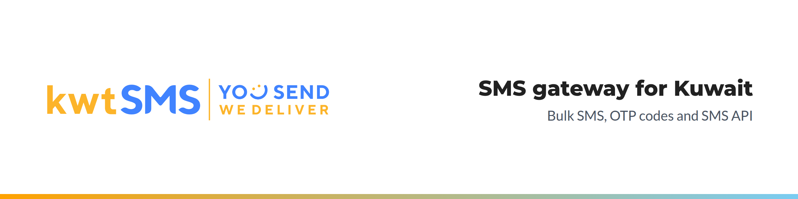

<picture>
  <source media="(prefers-color-scheme: dark)" srcset=".github/assets/readme-header-dark.png">
  
</picture>

# kwtsms-auth-relay

[](https://github.com/kwtsms/kwtsms-auth-relay/actions/workflows/ci.yml)
[](LICENSE)

Send the SMS of [Clerk](https://clerk.com), [Neon Auth](https://neon.com/docs/auth), [Okta](https://www.okta.com) and [WSO2 Identity Server](https://wso2.com/identity-server/) through kwtSMS, the Kuwaiti SMS gateway. Your auth provider makes the code and calls a webhook; this package checks the signature and sends the text. Test mode by default.

## About kwtSMS

kwtSMS is a Kuwaiti SMS gateway trusted by top businesses to deliver messages anywhere in the world, with private Sender ID, free API testing, non-expiring credits, and competitive flat-rate pricing. Secure, simple to integrate, built to last. Open a free account in under 1 minute, no paperwork or payment required. [Click here to get started](https://www.kwtsms.com/cportal/signup/)

## Install

```bash
npm install kwtsms-auth-relay
```

Requires Node.js 18 or newer (Node 20+ recommended). The handlers are plain `(Request) => Promise<Response>` functions, so they run on Next.js route handlers, Cloudflare Workers, Bun, Deno and Node. An Express adapter is included.

## Clerk

1. In the Clerk dashboard, open the SMS template you want to send yourself (for example "Verification code") and turn **Delivered by Clerk** off. Clerk then sends an `sms.created` webhook instead of the SMS.
2. Add a webhook endpoint pointing at your route, subscribe to `sms.created`, and copy the signing secret (`whsec_...`) into `CLERK_WEBHOOK_SIGNING_SECRET`.
3. Add the route:

```ts
// app/api/clerk-sms/route.ts (Next.js)
import { createClerkHandler } from "kwtsms-auth-relay/clerk";

export const POST = createClerkHandler({
  kwtsms: {
    username: process.env.KWTSMS_USERNAME,
    password: process.env.KWTSMS_PASSWORD,
    senderId: process.env.KWTSMS_SENDER_ID, // your own Sender ID, needed for live
    live: process.env.KWTSMS_LIVE === "1",
  },
  appName: "Shop",
});
```

The signing secret is read from `CLERK_WEBHOOK_SIGNING_SECRET`, or pass `signingSecret`. The text Clerk built is sent as is (cleaned for SMS). To send your own text, for example in Arabic, use `message`: a string with `{message}`, `{app}` and any key of Clerk's `data` such as `{otp_code}`, or a function that receives Clerk's SMS data.

Step-by-step guide: [guides/clerk.md](guides/clerk.md) (with screenshots), also on [kwtsms.com/integrations/clerk.html](https://www.kwtsms.com/integrations/clerk.html) in English and Arabic.

## Neon Auth

1. In Neon Auth, register a webhook for the blocking event `send.otp` pointing at your route.
2. Add the route:

```ts
// app/api/neon-otp/route.ts (Next.js)
import { createNeonHandler } from "kwtsms-auth-relay/neon";

export const POST = createNeonHandler({
  neonAuthUrl: process.env.NEON_AUTH_URL!, // keys are read from <neonAuthUrl>/.well-known/jwks.json
  kwtsms: { username: process.env.KWTSMS_USERNAME, password: process.env.KWTSMS_PASSWORD, senderId: process.env.KWTSMS_SENDER_ID, live: process.env.KWTSMS_LIVE === "1" },
  appName: "Shop",
  lang: "ar", // "en" (default) or "ar"
});
```

Only OTPs with `delivery_preference: "sms"` are sent. The text is `Shop: your code is 123456. Valid 5 min. Do not share it.` (English, one SMS part) or the Arabic equivalent (one part). Use `message` to replace it: a string with `{code}`, `{app}` and `{otp_type}`, or a function that receives the payload. The built-in text says "Valid 5 min", so set `message` if your expiry differs.

Local testing: expose your dev server with a tunnel (for example `cloudflared tunnel --url http://localhost:3000`) and register the tunnel URL as the webhook.

Step-by-step guide: [guides/neon-auth.md](guides/neon-auth.md) (with screenshots), also on [kwtsms.com/integrations/neon-auth.html](https://www.kwtsms.com/integrations/neon-auth.html) in English and Arabic.

## Okta

Okta allows one telephony inline hook per org. When it is active, Okta sends every SMS and voice sign-in code to your hook instead of its own providers.

1. Add the route:

```ts
// app/api/okta-sms/route.ts (Next.js)
import { createOktaHandler } from "kwtsms-auth-relay/okta";

export const POST = createOktaHandler({
  kwtsms: {
    username: process.env.KWTSMS_USERNAME,
    password: process.env.KWTSMS_PASSWORD,
    senderId: process.env.KWTSMS_SENDER_ID,
    live: process.env.KWTSMS_LIVE === "1",
  },
  appName: "Shop",
});
```

2. In the Okta Admin Console open **Workflow, Inline Hooks, Add Inline Hook, Telephony**. Enter your route URL (public HTTPS), set **Authentication field** to `authorization` and **Authentication secret** to a long random value. Put the same value in `OKTA_HOOK_SECRET` (at least 16 characters), or pass `secret`. A different header name goes in `authHeader`.

How it answers Okta:

| Case | Answer |
| --- | --- |
| Live mode, kwtSMS accepted the SMS | `SUCCESSFUL`, provider `kwtSMS`, the kwtSMS msg-id as `transactionId` |
| Test mode (default) | The SMS is queued with `test=1`, then an error object. Okta then sends the code through its own providers, so nobody is locked out while you test. `reportTestAsSuccess: true` answers `SUCCESSFUL` instead (for the Preview tab only: the code is not delivered) |
| Voice call, refused number, hourly cap, kwtSMS `ERR` code, timeout | An error object. Okta falls back to its own providers |
| Wrong or missing secret | 401 |

Okta waits 3 seconds for the answer, so the handler stops waiting for kwtSMS after 2.5 seconds (`sendTimeoutMs`). If kwtSMS accepts the message after that, Okta also sends the code through its own providers, so the user can get it twice. Run the route close to the internet, not on a cold-starting function, to keep this rare.

Okta defaults differ from Clerk and Neon: no resend cooldown (`cooldownSeconds: 0`) and `maxPerHour: 10`. A refused send is handed back to Okta, so a limit saves your credits but does not stop Okta from sending. The built-in text is Arabic when the Okta user's locale starts with `ar`, else English; `message` and `lang` work as for Neon (`{code}` and `{app}`). Okta's own message template is not used.

## WSO2 Identity Server

WSO2 Identity Server 7.x (and Asgardeo) can post every SMS to a custom provider. The handler takes that post and sends the text through kwtSMS. WSO2 sends numbers with a `+`, which the kwtSMS API does not accept, so WSO2 cannot post to kwtSMS directly.

1. Add the route:

```ts
// app/api/wso2-sms/route.ts (Next.js)
import { createWso2Handler } from "kwtsms-auth-relay/wso2";

export const POST = createWso2Handler({
  kwtsms: {
    username: process.env.KWTSMS_USERNAME,
    password: process.env.KWTSMS_PASSWORD,
    senderId: process.env.KWTSMS_SENDER_ID,
    live: process.env.KWTSMS_LIVE === "1",
  },
});
```

2. In the WSO2 Console open **Notification Channels, SMS Provider, Custom** and fill in:

| Field | Value |
| --- | --- |
| SMS Provider URL | your route URL (public HTTPS) |
| Content Type | `JSON` |
| HTTP Method | `POST` |
| Payload Template | `{"to": {{mobile}}, "content": {{body}}}` |
| Headers | `authorization: <a long random value>` |

Put the same random value in `WSO2_SMS_SECRET` (at least 16 characters), or pass `secret`. WSO2 writes the text itself (its SMS templates), so `message` and `lang` are not used here.

How it answers WSO2: 200 when kwtSMS accepted the message (`"test": true` in test mode, the message is queued, not delivered), 422 for a refused number or limit, 502 with the kwtSMS `ERR` code, 503 when kwtSMS did not answer, 401 for a wrong secret. Any answer other than 200 makes WSO2 report the send as failed. Defaults: no resend cooldown, `maxPerHour: 10`.

## Authgear (no relay needed)

Authgear's Custom SMS Gateway (enterprise plan) runs your own script, so it can call kwtSMS directly. Paste [recipes/authgear-custom-sms.ts](recipes/authgear-custom-sms.ts) into **Advanced, Custom SMS Gateway, Custom JS/TS**, set your API username, password and Sender ID, and click **Test**. It starts in test mode; set `TEST_MODE = false` to deliver. kwtSMS errors map to Authgear's answer codes (`authentication_failed`, `invalid_phone_number`, `rate_limited`, `delivery_rejected`) with the `ERR` code shown in the Authgear Portal.

## Express

```ts
app.post("/webhooks/clerk", express.raw({ type: "*/*" }), toExpress(createClerkHandler({ kwtsms })));
app.use(express.json()); // after the webhook routes
```

Signatures cover the raw body, so mount the webhook routes before `express.json()`. More in [examples/](examples/): Next.js, Cloudflare Worker, Express.

## Test mode and live mode

By default `kwtsms.live` is `false`: kwtSMS accepts and queues the message (`test=1`) but does not deliver it, and a warning prints at startup. Set `live: true` to deliver. Live mode throws at startup if credentials are missing or `senderId` is the shared `KWT-SMS`.

Sender ID: a private Sender ID is what recipients see as the sender. Register yours in the kwtSMS portal; for Kuwait numbers it must be approved before live delivery works. See https://www.kwtsms.com/support.html.

## Options (both handlers)

| Option | Default | Meaning |
| --- | --- | --- |
| `kwtsms.username`, `kwtsms.password` | none | kwtSMS API credentials (not your account mobile number) |
| `kwtsms.senderId` | `"KWT-SMS"` | Sender ID; the shared `KWT-SMS` is for testing only |
| `kwtsms.live` | `false` | `false` = test mode (`test=1`), `true` = real delivery |
| `appName` | `"App"` | Name shown in the message, ASCII, 16 characters max |
| `allowedCountries` | `["965"]` | Country codes allowed to receive SMS; others are refused before any send |
| `cooldownSeconds` | `60` | Per-number resend cooldown, `0` disables |
| `maxPerHour` | `5` | Per-number cap per hour, `0` disables |
| `store` | in-memory | `{ get, set(key, value, ttlSeconds), delete? }` for dedupe, cooldown and caps |
| `sendTimeoutMs` | `4000` | Stop waiting for kwtSMS (Neon's own timeout is 5 s by default) |
| `onError` | none | Called with the `ERR` code and a masked number after a failed send |

Numbers: 8-digit Kuwait local numbers, `+965`, `00965`, Arabic and Persian digits are accepted.

## How it answers

| Case | Status |
| --- | --- |
| Bad or missing signature, stale timestamp (older than 5 minutes), unknown key | 401 |
| Sent, or kwtSMS answered with an `ERR` code (logged, no retry storm), or the answer timed out | 200 |
| Skipped: other event type, Clerk `delivered_by_clerk: true`, Neon `delivery_preference` not `sms`, duplicate event id, refused number, cooldown or cap | 200 |
| Nothing was sent (DNS or connect error, Neon keys unreachable) | 503, so the provider retries |

A provider retry never sends twice: the event id (`svix-id`, `X-Neon-Event-Id`) is claimed in the store first.

## Serverless and several instances

The default store is in memory, so dedupe, cooldown and the hourly cap are per instance. On serverless (Vercel, Workers) or more than one server, pass a shared `store` (KV, Redis). The counter is read then written, so under heavy parallel load the cap is approximate.

## Logs

Logs hold only the `ERR` code and a masked number such as `965****567`. The code and the message text are never logged.

## Troubleshooting

Nothing arrives:

- Test mode: `live` is not `true`, so kwtSMS queues the message without delivering it. Delete test messages from the kwtSMS queue to release their credits.
- Allowlist: the number is outside `allowedCountries` (default Kuwait only).
- Sender ID: in live mode a Kuwait number needs your approved Sender ID.
- Clerk: "Delivered by Clerk" is still on, so no webhook is sent.
- 401 in the provider's webhook log: wrong signing secret or `neonAuthUrl`, or the server clock is off by more than 5 minutes.

## Arabic (العربية)

ترسل هذه المكتبة رسائل SMS الخاصة بمزودي المصادقة Clerk وNeon Auth عبر kwtSMS. المزود ينشئ الرمز ويستدعي رابط webhook، والمكتبة تتحقق من التوقيع ثم ترسل الرسالة.

- الوضع الافتراضي هو وضع التجربة: الرسالة تدخل طابور الارسال ولا تُسلّم، ويُحجز الرصيد حتى تحذفها من طابور الارسال. فعّل `live: true` للإرسال الفعلي.
- في الوضع الفعلي يلزم اسم المرسل الخاص بحسابك، ولا يُقبل اسم المرسل التجريبي `KWT-SMS`.
- في Clerk: أوقف خيار "Delivered by Clerk" في قالب الرسالة، ثم سجّل رابط الـ webhook للحدث `sms.created`. لإرسال نص عربي استخدم الخيار `message`.
- في Neon Auth: سجّل رابط الـ webhook للحدث `send.otp`، واستخدم `lang: "ar"` لنص عربي.
- يُقبل الرقم الكويتي من 8 أرقام، أو `+965`، أو `00965`، بالأرقام العربية أو الفارسية أو الإنجليزية، ولا تُرسل الرسائل إلى دول غير مسموحة في `allowedCountries`.
- للدعم: https://www.kwtsms.com/support.html

## FAQ

**Does it work without Clerk or Neon?** No, it only relays their SMS webhooks. For Better Auth use [better-auth-kwtsms](https://github.com/kwtsms/kwtsms-better-auth).

**Why 200 when kwtSMS returns an error?** A retry would not fix a wrong Sender ID or an empty balance, and would repeat the send. The `ERR` code is logged instead.

**Can I send to other countries?** Yes: `allowedCountries: ["965", "971"]`. The default is Kuwait only, so a bot cannot burn credits on foreign numbers.

**Where do I find my API credentials and Sender ID?** In your kwtSMS account. Docs: https://www.kwtsms.com/api-documentation.html

## Support

- https://www.kwtsms.com/support.html
- https://www.kwtsms.com/api-documentation.html

## License

MIT, see [LICENSE](LICENSE).
