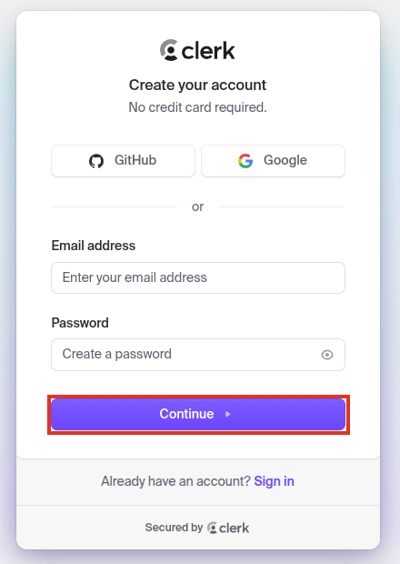
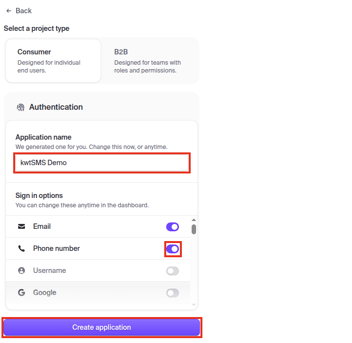
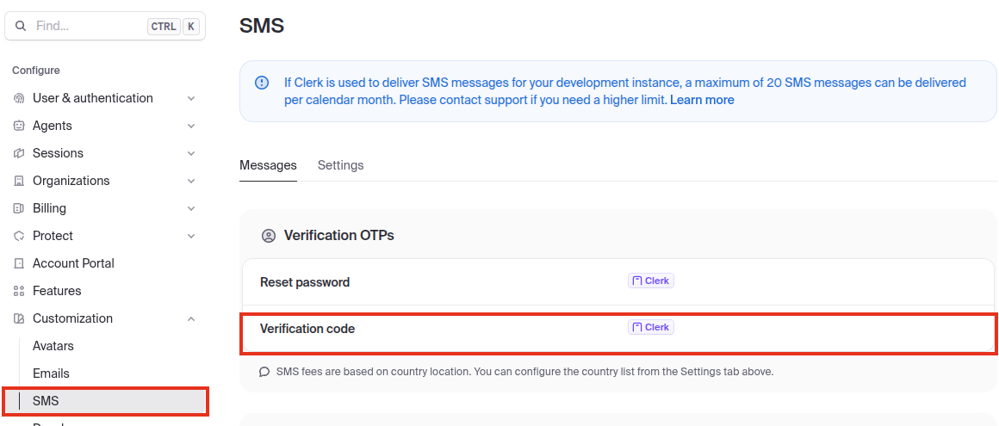
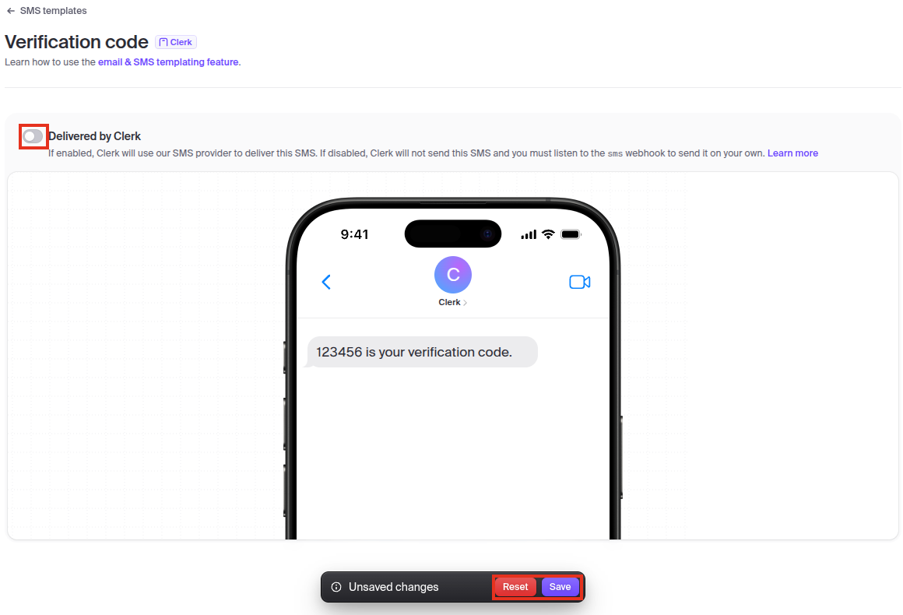
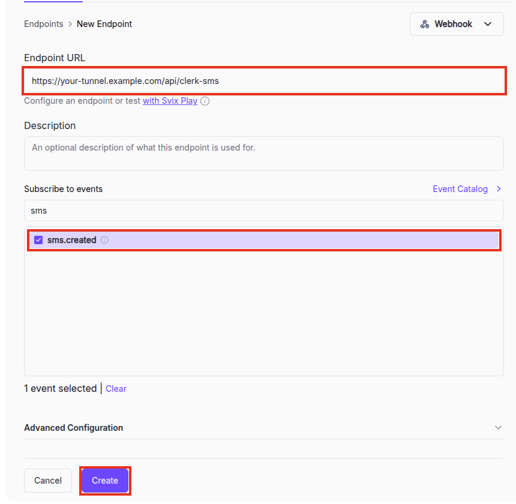
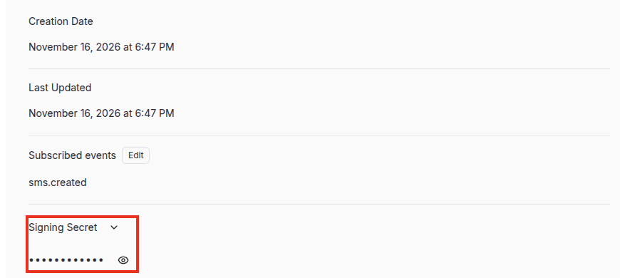

# Clerk + kwtSMS: step-by-step setup

Send the sign-in SMS codes of Clerk through kwtSMS, the Kuwaiti SMS gateway, with `kwtsms-auth-relay`.

How it works: you turn off Clerk's own SMS delivery for a template. Clerk then calls your server with an `sms.created` webhook. The package checks the signature and sends the text through kwtSMS.

## Who this is for

Developers who use Clerk for sign-in and want the phone codes (and other Clerk SMS) to go out through their own kwtSMS account, with their own Sender ID, to Kuwait numbers.

## What you need

- A Clerk account. The free plan is enough. No card is asked at sign-up.
- A kwtSMS account with the API enabled. Open one free at https://www.kwtsms.com/cportal/signup/ . You need your **API username** and **API password** (not your mobile number). See https://www.kwtsms.com/api-documentation.html
- A Next.js app, or any Node 18+ server that can receive an HTTPS POST. Node 20+ is recommended.
- For local testing: a tunnel tool such as `cloudflared`, `ngrok` or `localtunnel`.

## Part 1: Set up Clerk

### Step 1. Create a Clerk account

Go to https://dashboard.clerk.com/sign-up and sign up with an email address (or GitHub or Google). Clerk sends a code to your email. Enter it.



### Step 2. Create the application

1. Name the application.
2. Under **Sign in options**, keep **Email** and turn **Phone number** on. Phone sign-in is what makes Clerk send SMS codes.
3. Click **Create application**.



Already have an application? Open **Configure**, then **User & authentication**, then the **Phone** tab, and enable phone there.

### Step 3. Turn off "Delivered by Clerk" on the SMS template

1. In the dashboard, open **Configure**.
2. In the left menu open **Customization**, then **SMS**.
3. Under **Verification OTPs**, click **Verification code**.



4. Turn **Delivered by Clerk** off.
5. Click **Save** in the "Unsaved changes" bar at the bottom. Wait for "Saved!".



This is a per-template setting. Repeat it for every SMS template you want to send through kwtSMS, for example **Reset password**. A template that stays on "Delivered by Clerk" is still sent by Clerk, not by you.

Once it is off, Clerk no longer sends that SMS. Your webhook must send it. Until you finish Part 3, those codes are not delivered.

### Step 4. Add the webhook endpoint

You need a public HTTPS URL for this step. If your route is not deployed yet, use your tunnel URL from "Test locally" below, or add a placeholder now and edit it later (Clerk shows an **Edit** button on the endpoint page).

1. Open **Configure**, then **Developers**, then **Webhooks**.
2. On the **Endpoints** tab click **Add Endpoint**.
3. **Endpoint URL**: the full URL of your route, for example `https://your-domain.example.com/api/clerk-sms`.
4. Under **Subscribe to events**, type `sms` in the search box and tick **sms.created**. Subscribe to this event only.
5. Click **Create**.



### Step 5. Copy the signing secret

On the endpoint page scroll down to **Signing Secret**. Click the eye icon to show it, then copy the value. It starts with `whsec_`.



Keep it private. You will put it in `CLERK_WEBHOOK_SIGNING_SECRET` in the next part. Never commit it to git.

## Part 2: Set up kwtSMS

1. Log in to your kwtSMS account and open **API Integration** in the menu. Make sure API access is on and note your API username and API password.
2. Sender ID: the shared `KWT-SMS` is for testing only. For live delivery to Kuwait numbers, use your own Sender ID (see **Buy SenderID** and **SenderID list** in your account). For sign-in codes, use a Transactional Sender ID. It must be approved before live delivery works. Help: https://www.kwtsms.com/support.html

## Part 3: Add the relay to your app

### Step 6. Install

```bash
npm install kwtsms-auth-relay
```

### Step 7. Add the route (Next.js)

Create `app/api/clerk-sms/route.ts`:

```ts
import { createClerkHandler } from "kwtsms-auth-relay/clerk";

export const POST = createClerkHandler({
  kwtsms: {
    username: process.env.KWTSMS_USERNAME,
    password: process.env.KWTSMS_PASSWORD,
    senderId: process.env.KWTSMS_SENDER_ID, // your own Sender ID, needed for live
    live: process.env.KWTSMS_LIVE === "1",
  },
  appName: "Shop", // shown in the message, ASCII, 16 characters max
});
```

Not on Next.js? The handler is a plain `(Request) => Promise<Response>` function. It also runs on Cloudflare Workers, Bun, Deno and Node. For Express, mount it with the `toExpress` adapter, before `express.json()`, because the signature covers the raw body. See the `examples/` folder of the package.

If you use Clerk's `clerkMiddleware()`, make sure this route is not protected. Clerk must be able to POST to it without a session.

### Step 8. Set the environment variables

Put these in `.env.local` (Next.js) or your host's environment settings:

```bash
CLERK_WEBHOOK_SIGNING_SECRET=whsec_paste_the_value_from_step_5
KWTSMS_USERNAME=your_api_username
KWTSMS_PASSWORD=your_api_password
KWTSMS_SENDER_ID=YourSenderID
KWTSMS_LIVE=0
```

| Variable | Meaning |
| --- | --- |
| `CLERK_WEBHOOK_SIGNING_SECRET` | The `whsec_...` value from Step 5. The handler throws at startup if it is missing (unless you pass `signingSecret`). |
| `KWTSMS_USERNAME`, `KWTSMS_PASSWORD` | Your kwtSMS API credentials. |
| `KWTSMS_SENDER_ID` | Your own Sender ID. The default is the shared `KWT-SMS`, which is refused in live mode. |
| `KWTSMS_LIVE` | `1` = real delivery. Anything else = test mode. Start with `0`. |

Restart your server after you change them.

### Optional: your own text

By default the text Clerk built is sent as is, cleaned for SMS. To send your own text (Arabic works too), add `message`:

```ts
message: "{app}: your code is {otp_code}. Do not share it.",
```

A string may use `{message}`, `{app}` and any key of Clerk's `data` such as `{otp_code}`. A function that receives Clerk's SMS data also works.

## Part 4: Test

### Step 9. Test locally with a tunnel

Clerk cannot reach `localhost`. Expose your dev server:

```bash
npm run dev
cloudflared tunnel --url http://localhost:3000
```

The tunnel prints an `https://...` address. In Clerk, set the endpoint URL to that address plus your route path, for example `https://random-words.trycloudflare.com/api/clerk-sms`. Use **Edit** on the endpoint page. (ngrok and localtunnel work the same way.)

Keep `KWTSMS_LIVE=0`. Then trigger a code:

1. Add Clerk sign-in to your app if you have not yet (Clerk Next.js quickstart: https://clerk.com/docs/nextjs/getting-started/quickstart ).
2. Open your sign-in page and sign up or sign in with a phone number, written like `965XXXXXXXX` (use your own number).
3. Clerk sends `sms.created` to your route. Your server log prints the test-mode warning at startup. A failed send prints `send failed: <ERR code>` with a masked number.

You can also watch the delivery in Clerk: **Configure**, **Developers**, **Webhooks**, open your endpoint, and check **Logs** or **Delivery Stats**. A `200` answer means the event was handled.

### Step 10. Check the message in your kwtSMS account

In test mode kwtSMS accepts the message and queues it. It is **not delivered** to the phone, and nothing reaches the handset.

1. Log in to your kwtSMS account.
2. Open **Queue** (the Sending Queue).
3. Find your test message. Check the number and the text.
4. Delete it from the queue. In test mode the credits are held until you delete the message. Deleting it releases them.

## Part 5: Go live

1. Make sure your Sender ID is approved in your kwtSMS account.
2. Set `KWTSMS_LIVE=1`, and `KWTSMS_SENDER_ID` to your own Sender ID. Live mode throws at startup if the username or password is missing, or if the Sender ID is still `KWT-SMS`.
3. Deploy your route to a public HTTPS address. Point the Clerk endpoint to it (Step 4).
4. Check the same two settings on your Clerk production instance: **Delivered by Clerk** off on the template, and an endpoint subscribed to `sms.created` with its own signing secret.
5. Run one real sign-in with your own number. The message now reaches the phone and uses credits.

On serverless or with several server instances, pass a shared `store` (KV or Redis). The default store is in memory, so dedupe, the resend cooldown and the hourly cap only work inside one process. See the package README for the `store` option.

Defaults that protect your credits: Kuwait numbers only (`allowedCountries: ["965"]`), a 60 second cooldown per number, and 5 sends per number per hour.

## Troubleshooting

What your route answers, as the code behaves:

| You see | Meaning | Fix |
| --- | --- | --- |
| `401 {"status":"bad_signature"}` | The signature check failed: wrong or old `whsec_` secret, a secret from another endpoint or another Clerk instance, a body changed by a proxy or middleware, or a request older than 5 minutes. | Copy the secret again from this endpoint (Step 5), restart the server. Do not parse or alter the body before the handler. |
| Server fails to start: `signingSecret (or env CLERK_WEBHOOK_SIGNING_SECRET) is required` | The env var is not set. | Set it and restart. |
| Server fails to start in live mode: `live mode needs username and password` / `needs your own senderId` | Missing credentials, or the Sender ID is empty or `KWT-SMS`. | Set `KWTSMS_USERNAME`, `KWTSMS_PASSWORD`, and your own `KWTSMS_SENDER_ID`. |
| `405` | Something other than POST reached the route (a browser visit, for example). | Normal. Only Clerk's POST is accepted. |
| `413 too_large` | Body larger than 64 KB. | Not expected from Clerk. Check what is calling the route. |
| `200 {"status":"skipped","reason":"event_type"}` | The endpoint receives an event other than `sms.created`. | Subscribe to `sms.created` only. |
| `200 {"status":"skipped","reason":"delivered_by_clerk"}` | Clerk is still sending this SMS itself. Nothing is sent by you, to avoid a double SMS. | Turn **Delivered by Clerk** off on that template (Step 3) and save. |
| `200 {"status":"refused","reason":"COUNTRY_NOT_ALLOWED"}` | The number is outside `allowedCountries` (default Kuwait only). | Add the country code, for example `allowedCountries: ["965", "971"]`. |
| `200 {"status":"refused","reason":"INVALID_PHONE"}` | The number could not be read as a valid phone number. | Use a full international number. |
| `200 {"status":"refused","reason":"COOLDOWN"}` | The same number asked again inside the cooldown (default 60 s) or passed the hourly cap (default 5). | Wait, or change `cooldownSeconds` / `maxPerHour`. |
| `200 {"status":"duplicate"}` | Clerk retried an event that was already handled. Nothing is sent twice. | Normal. |
| `200 {"status":"failed","code":"ERR..."}` | kwtSMS answered with an error, for example a wrong API username or password, an unapproved Sender ID or an empty balance. The `ERR` code is logged with a masked number. `200` is returned on purpose so Clerk does not retry and repeat the send. | Look up the code at https://www.kwtsms.com/api-documentation.html . Use `onError` to alert yourself. |
| `503 {"status":"not_sent"}` | The request never reached kwtSMS (DNS or connect error). Clerk retries. | Check that your server can reach the internet. |
| `200 {"status":"failed","code":"MESSAGE_BUILDER"}` | Your `message` function threw an error. | Fix the function. |

Other things to check:

- No webhook calls at all: the endpoint URL is wrong or not public, the tunnel changed address (free tunnels get a new address each run), or the route is behind a login or middleware.
- Message is in the kwtSMS Queue but never arrives: you are in test mode (`KWTSMS_LIVE` is not `1`). Test messages are queued, not delivered.
- Arabic text looks wrong or costs more: Arabic uses Unicode, so one SMS part holds fewer characters. Keep the text short.

## Documentation used

Clerk pages read for this guide:

- Webhooks overview: https://clerk.com/docs/guides/development/webhooks/overview
- Debug your webhooks (tunnels, middleware): https://clerk.com/docs/guides/development/webhooks/debugging
- Email and SMS templates (Delivered by Clerk): https://clerk.com/docs/guides/customizing-clerk/email-sms-templates
- Next.js quickstart: https://clerk.com/docs/nextjs/getting-started/quickstart

kwtSMS API documentation: https://www.kwtsms.com/api-documentation.html

Screenshots were taken from the Clerk dashboard in November 2026. Menu names may change; if they differ, follow the Clerk pages above.
