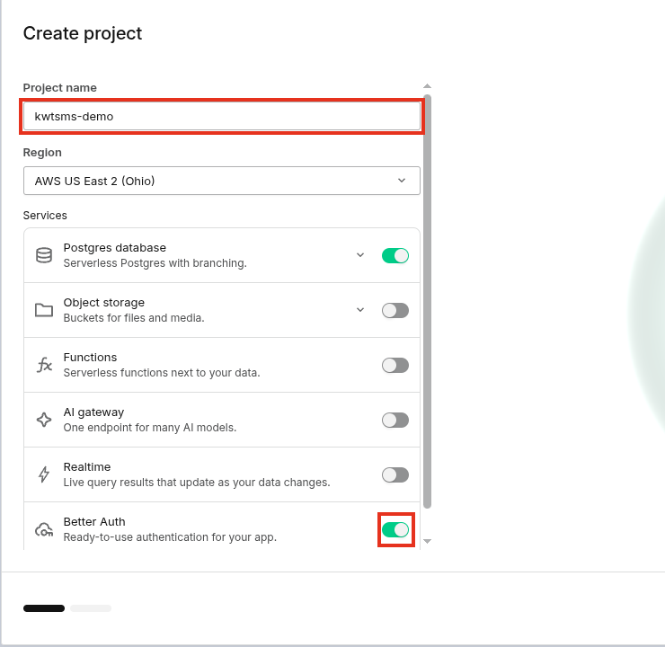
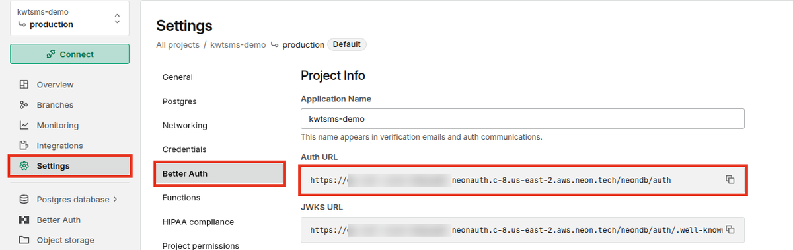
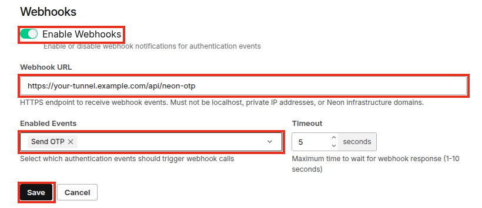

# Neon Auth + kwtSMS: step-by-step setup

Send the phone sign-in codes of Neon Auth through kwtSMS, the Kuwaiti SMS gateway, with `kwtsms-auth-relay`.

Neon now calls this product "Better Auth" ("Managed Better Auth" in its docs). In the console you will see **Better Auth**. The package and this guide still say Neon Auth.

How it works: Neon Auth does not send SMS itself. When a user asks for a phone code, Neon calls your server with a `send.otp` webhook. The package checks the signature and sends the text through kwtSMS.

## Who this is for

Developers who use Neon Auth and want phone sign-in codes to go out through their own kwtSMS account, with their own Sender ID, to Kuwait numbers.

## What you need

- A Neon account. The free plan is enough.
- A kwtSMS account with the API enabled. Open one free at https://www.kwtsms.com/cportal/signup/ . You need your **API username** and **API password** (not your mobile number). See https://www.kwtsms.com/api-documentation.html
- A Next.js app, or any Node 18+ server that can receive an HTTPS POST. Node 20+ is recommended.
- A public HTTPS address for your route. Neon rejects `localhost`, private IPs, raw IP addresses and plain `http://`. For local testing use a tunnel such as `cloudflared` or `ngrok`.

Important: Neon's Phone Number plugin is sign-in only. The user must already exist and have a verified phone number linked to their account. There is no phone-first sign-up. Step 8 shows how to link a number.

## Part 1: Set up Neon

### Step 1. Create the project with Better Auth on

1. Open the Neon Console: https://console.neon.tech
2. Click **Create project**.
3. Enter a **Project name**.
4. Under **Services**, turn **Better Auth** on. (Postgres database is on by default.)
5. Click **Create project**.



Already have a project? Skip to Step 2 and open **Settings > Better Auth**.

### Step 2. Open the Better Auth settings and copy the Auth URL

1. Open your project.
2. In the left menu click **Settings**.
3. In the settings menu click **Better Auth**.
4. Under **Project Info**, copy the **Auth URL**. It ends in `/auth`. This is your `NEON_AUTH_URL`.



The package reads Neon's signing keys from `<Auth URL>/.well-known/jwks.json`. That is the **JWKS URL** shown just below the Auth URL. You do not need to copy it.

### Step 3. Enable Phone Authentication

On the same page scroll down to **Phone Authentication** and turn **Enable Phone Authentication** on. **OTP Expiry** is how long a code stays valid (60 to 600 seconds, default 300).


The page reminds you that phone OTP needs a webhook with the `send.otp` event. That is the next step.

Note: the built-in message of this package says "Valid 5 min". If you change **OTP Expiry**, set the `message` option so the text matches (see Optional below).

### Step 4. Register the send.otp webhook

On the same **Settings > Better Auth** page scroll to **Webhooks**.

1. Turn **Enable Webhooks** on.
2. **Webhook URL**: your public HTTPS address plus the route, for example `https://your-domain.example.com/api/neon-otp`.
3. **Enabled Events**: open the list and pick **Send OTP**.
4. Leave **Timeout** at 5 seconds (allowed 1 to 10). The package stops waiting for kwtSMS after 4 seconds, inside that limit.
5. Click **Save**.



URL rules from Neon: HTTPS only, a hostname (not an IP address), no localhost or private network, and no redirects. Neon does not follow `3xx` answers, so give the final URL.

If you do not have a public URL yet, finish Part 3 and the tunnel step first, then come back and set the URL.

Neon's docs name this place **Auth > Configuration > Webhooks**. In the console shown here the same settings are under **Settings > Better Auth**. Neon's docs also show the same setting through the CLI and the API: `neon neon-auth config webhook update --enabled --url <url> --enabled-events send.otp --timeout 5`.

Once `send.otp` is subscribed, Neon stops its own delivery for that event. Your handler must deliver the code.

## Part 2: Set up kwtSMS

1. Log in to your kwtSMS account and open **API Integration** in the menu. Make sure API access is on and note your API username and API password.
2. Sender ID: the shared `KWT-SMS` is for testing only. For live delivery to Kuwait numbers, use your own Sender ID (see **Buy SenderID** and **SenderID list** in your account). For sign-in codes, use a Transactional Sender ID. It must be approved before live delivery works. Help: https://www.kwtsms.com/support.html

## Part 3: Add the relay to your app

### Step 5. Install

```bash
npm install kwtsms-auth-relay
```

### Step 6. Add the route (Next.js)

Create `app/api/neon-otp/route.ts`:

```ts
import { createNeonHandler } from "kwtsms-auth-relay/neon";

export const POST = createNeonHandler({
  neonAuthUrl: process.env.NEON_AUTH_URL!, // keys are read from <neonAuthUrl>/.well-known/jwks.json
  kwtsms: {
    username: process.env.KWTSMS_USERNAME,
    password: process.env.KWTSMS_PASSWORD,
    senderId: process.env.KWTSMS_SENDER_ID, // your own Sender ID, needed for live
    live: process.env.KWTSMS_LIVE === "1",
  },
  appName: "Shop", // shown in the message, ASCII, 16 characters max
  lang: "en", // "en" (default) or "ar"
});
```

Not on Next.js? The handler is a plain `(Request) => Promise<Response>` function. It also runs on Cloudflare Workers, Bun, Deno and Node. For Express, mount it with the `toExpress` adapter, before `express.json()`, because the signature covers the raw body. See the `examples/` folder of the package.

The handler only sends OTPs where Neon says `delivery_preference` is `"sms"`. Email OTPs and other events are answered with 200 and skipped. The built-in text is `Shop: your code is 123456. Valid 5 min. Do not share it.` (one SMS part), or the Arabic equivalent with `lang: "ar"`.

### Step 7. Set the environment variables

Put these in `.env.local` (Next.js) or your host's environment settings:

```bash
NEON_AUTH_URL=https://paste-the-auth-url-from-step-2/neondb/auth
KWTSMS_USERNAME=your_api_username
KWTSMS_PASSWORD=your_api_password
KWTSMS_SENDER_ID=YourSenderID
KWTSMS_LIVE=0
```

| Variable | Meaning |
| --- | --- |
| `NEON_AUTH_URL` | The **Auth URL** from Step 2. Used to fetch the keys that verify Neon's signature. |
| `KWTSMS_USERNAME`, `KWTSMS_PASSWORD` | Your kwtSMS API credentials. |
| `KWTSMS_SENDER_ID` | Your own Sender ID. The default is the shared `KWT-SMS`, which is refused in live mode. |
| `KWTSMS_LIVE` | `1` = real delivery. Anything else = test mode. Start with `0`. |

Neon uses a public key signature (Ed25519), so there is no shared secret to copy. Restart your server after you change the variables.

### Optional: your own text

To replace the built-in text, add `message`:

```ts
message: "{app}: your code is {code}. Do not share it.",
```

A string may use `{code}`, `{app}` and `{otp_type}`. A function that receives the webhook payload also works.

## Part 4: Test

### Step 8. Test locally with a tunnel

Neon cannot reach `localhost`. Expose your dev server:

```bash
npm run dev
cloudflared tunnel --url http://localhost:3000
```

The tunnel prints an `https://...` address. In Neon (Step 4) set **Webhook URL** to that address plus your route, for example `https://random-words.trycloudflare.com/api/neon-otp`, and click **Save**. Free tunnels get a new address each run, so update the URL each time.

Keep `KWTSMS_LIVE=0`. Neon has no "send test event" button and no event log, so you test with a real sign-in flow:

1. Link a phone number to a test user. As a signed-in user call `authClient.phoneNumber.sendOtp({ phoneNumber })` and then `authClient.phoneNumber.verify({ phoneNumber, code, updatePhoneNumber: true })`. Write the number in international format, for example `+965XXXXXXXX`. Neon's example app shows the full form: https://github.com/neondatabase/neon-js/tree/main/examples/nextjs-phone-login
2. Sign out. On the sign-in form, ask for a phone code with the same number: `authClient.phoneNumber.sendOtp({ phoneNumber })`, without `updatePhoneNumber`.
3. Neon calls your route with `send.otp`. In test mode kwtSMS queues the message but does not deliver it, so the code does not arrive on the phone. A failed send prints `send failed: <ERR code>` with a masked number in your server log.

### Step 9. Check the message in your kwtSMS account

In test mode kwtSMS accepts the message and queues it. It is **not delivered** to the phone.

1. Log in to your kwtSMS account.
2. Open **Queue** (the Sending Queue).
3. Find your test message. Check the number and the text.
4. Delete it from the queue. In test mode the credits are held until you delete the message. Deleting it releases them.

## Part 5: Go live

1. Make sure your Sender ID is approved in your kwtSMS account.
2. Set `KWTSMS_LIVE=1`, and `KWTSMS_SENDER_ID` to your own Sender ID. Live mode throws at startup if the username or password is missing, or if the Sender ID is still `KWT-SMS`.
3. Deploy your route to a public HTTPS address. In **Settings > Better Auth > Webhooks** set the **Webhook URL** to it and **Save**.
4. Run one real phone sign-in with your own number. The message now reaches the phone and uses credits.

On serverless or with several server instances, pass a shared `store` (KV or Redis). The default store is in memory, so dedupe, the resend cooldown and the hourly cap only work inside one process. See the package README for the `store` option.

Defaults that protect your credits: Kuwait numbers only (`allowedCountries: ["965"]`), a 60 second cooldown per number, and 5 sends per number per hour.

## Troubleshooting

What your route answers, as the code behaves:

| You see | Meaning | Fix |
| --- | --- | --- |
| `401 {"status":"bad_signature"}` | The signature check failed: the request did not come from your Neon Auth, the `NEON_AUTH_URL` belongs to another project or branch, the body was changed by a proxy, or the timestamp is more than 5 minutes off. | Check `NEON_AUTH_URL` is the Auth URL of the project and branch that has the webhook. Do not parse or alter the body before the handler. Check the server clock. Neon does not retry a 401. |
| `503 {"status":"keys_unavailable"}` | Your server could not download Neon's keys from `<NEON_AUTH_URL>/.well-known/jwks.json`. Neon retries. | Open that URL in a browser. Check that the server can reach it and that `NEON_AUTH_URL` is the Auth URL, ending in `/auth`. |
| `503 {"status":"not_sent"}` | The request never reached kwtSMS (DNS or connect error). Neon retries. | Check that your server can reach the internet. |
| `405` | Something other than POST reached the route (a browser visit, for example). | Normal. |
| `413 too_large` | Body larger than 64 KB. | Not expected from Neon. Check what is calling the route. |
| `200 {"status":"skipped","reason":"delivery_preference"}` | The OTP is for email, not SMS. | Normal. The relay only handles SMS. |
| `200 {"status":"skipped","reason":"event_type"}` | The webhook sends an event other than `send.otp`. | Subscribe to **Send OTP** only. |
| `200 {"status":"skipped","reason":"missing_fields"}` | The payload has no code or no phone number. | Check the user has a phone number and the request came from the Phone Number plugin. |
| `200 {"status":"refused","reason":"COUNTRY_NOT_ALLOWED"}` | The number is outside `allowedCountries` (default Kuwait only). | Add the country code, for example `allowedCountries: ["965", "971"]`. |
| `200 {"status":"refused","reason":"INVALID_PHONE"}` | The number could not be read as a valid phone number. | Use a full international number. |
| `200 {"status":"refused","reason":"COOLDOWN"}` | The same number asked again inside the cooldown (default 60 s). | Wait, or change `cooldownSeconds`. |
| `200 {"status":"refused","reason":"RATE_LIMIT"}` | The number passed the hourly cap (default 5 SMS per hour). | Wait, or change `maxPerHour`. |
| `200 {"status":"duplicate"}` | Neon retried an event that was already handled. Nothing is sent twice. | Normal. |
| `200 {"status":"failed","code":"ERR..."}` | kwtSMS answered with an error, for example a wrong API username or password, an unapproved Sender ID or an empty balance. The `ERR` code is logged with a masked number. `200` is returned on purpose so Neon does not retry and repeat the send. | Look up the code at https://www.kwtsms.com/api-documentation.html . Use `onError` to alert yourself. |
| `200 {"status":"failed","code":"MESSAGE_BUILDER"}` | Your `message` function threw an error. | Fix the function. |
| Server fails to start in live mode: `live mode needs username and password` / `needs your own senderId` | Missing credentials, or the Sender ID is empty or `KWT-SMS`. | Set `KWTSMS_USERNAME`, `KWTSMS_PASSWORD`, and your own `KWTSMS_SENDER_ID`. |

Other things to check:

- Saving the webhook fails: the URL is `http://`, an IP address, localhost, or a private address. Use an HTTPS hostname.
- No webhook calls at all: **Enable Webhooks** is off, **Send OTP** is not selected, the tunnel changed address, or the route is behind a login or middleware.
- `sendOtp` returns an error in your app: without a subscribed `send.otp` webhook the Phone Number plugin cannot send codes. Check Step 4.
- Neon waits at most 5 seconds by default and 15 seconds in total over 3 attempts. If your route is slow, raise **Timeout** (up to 10).
- Message is in the kwtSMS Queue but never arrives: you are in test mode (`KWTSMS_LIVE` is not `1`). Test messages are queued, not delivered.
- Arabic text costs more: Arabic uses Unicode, so one SMS part holds fewer characters.

## Documentation used

Neon pages read for this guide:

- Webhooks (events, console path, URL rules, signature, retries): https://neon.com/docs/auth/guides/webhooks
- Phone Number plugin (enable, send.otp, link a phone): https://neon.com/docs/auth/guides/plugins/phone-number
- Managed Better Auth overview: https://neon.com/docs/auth/overview
- Neon example app for phone login: https://github.com/neondatabase/neon-js/tree/main/examples/nextjs-phone-login

kwtSMS API documentation: https://www.kwtsms.com/api-documentation.html

Screenshots were taken from the Neon Console in November 2026. Menu names may change; if they differ, follow the Neon pages above.
